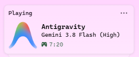

# Discord Rich Presence for Antigravity

[](https://nodejs.org)
[](LICENSE)
[](#requirements)
[](#installation)
[](#architecture)



A native Google Antigravity plugin that shows your Antigravity activity, including the active AI model, as Discord Rich Presence. It runs as a plugin-managed local MCP stdio server and needs no standalone app.

## Features

- **Plugin-managed lifecycle** — the MCP server starts when the plugin is enabled and stops when it is disabled or uninstalled; presence is cleared on shutdown
- **Live model display** — shows the active model from the official lifecycle hook `modelName` field, e.g. `gemini-3.8-flash-high` becomes `Gemini 3.8 Flash (High)`
- **Auto-reconnect** — retries every 5 seconds until Discord is available, and again if Discord restarts
- **Cross-platform IPC** — Windows named pipes, macOS and Linux Unix sockets
- **Fully configurable** — state/details text, images, and elapsed timer via `mcp_config.json`
- **Privacy-first** — only the model identifier and a timestamp are stored locally; prompts, transcripts, and conversation text are never read or written
- **Status tool** — ask Antigravity to "Check Discord Rich Presence status"
- **Stack** — Node.js (ESM, zero dependencies), MCP over stdio, Discord IPC

## Architecture

```
antigravity-discord-rpc/
├── plugin.json              # plugin manifest
├── mcp_config.json          # MCP server launch + activity settings (env vars)
├── hooks.json               # lifecycle hooks (SessionStart, PreInvocation, PostInvocation, Stop)
├── scripts/
│   ├── discord-presence.mjs # MCP stdio server, Discord IPC client, presence updates
│   └── model-state.mjs      # hook script, persists the current model name
├── LICENSE
└── README.md
```

**Flow:** Antigravity fires a lifecycle hook → `model-state.mjs` reads `modelName` from stdin and writes it atomically to `~/.gemini/antigravity/discord-rpc-model.json` (on Windows `%USERPROFILE%\.gemini\antigravity\`) → the MCP server polls that file every 5 seconds → on a model change it formats the name and sends `SET_ACTIVITY` over Discord IPC → Discord shows the updated presence.

**Limitation:** Antigravity hooks cover agent sessions and tool calls, not the `Antigravity.exe` process itself. They cannot detect desktop startup or shutdown, or keep a process alive past the hook timeout. A plugin-managed MCP server is the closest supported lifecycle. This plugin has no task scheduler, startup entry, or process watcher, and it does not target VS Code or other editors.

## Configuration

All settings live in the `env` block of `mcp_config.json`:

| Variable | Default | Description |
| --- | --- | --- |
| `DISCORD_APPLICATION_ID` | `1573947464581652570` | Optional. Override only if you want to use your own Discord application |
| `APPLICATION_NAME` | `Antigravity` | Display name used in logs |
| `DETAILS` | empty | Discord details line; leave empty to omit it |
| `STATE` | `AI-assisted development` | Fallback state text when no model is known |
| `LARGE_IMAGE` | `antigravity` | Art asset key for the large image |
| `SMALL_IMAGE` | empty | Art asset key for the small image |
| `ELAPSED_TIME` | `true` | Show the elapsed timer |

The detected model name overrides `STATE`. A model switch shows up on the next invocation, so send a message after switching models.

## Requirements

- Google Antigravity Desktop 2.x
- Node.js available on `PATH`
- Desktop Discord with the local RPC IPC server enabled
- Windows, macOS, or Linux

## Installation

```powershell
git clone https://github.com/ciasteczkox10/antigravity-discord-rpc
cd antigravity-discord-rpc
agy plugin validate --strict .
agy plugin install .
agy plugin list
```

Enable the plugin in Antigravity's **Customizations > Installed** panel, then restart Antigravity if presence doesn't appear.

## Troubleshooting

- **Nothing shows in Discord** — make sure desktop Discord is running and Activity Status is enabled in Discord's settings
- **Model not updating** — send a message after switching models to trigger the next hook event
- **Plugin not detected** — run `agy plugin list` and restart Antigravity after installing

## Validate

```powershell
agy plugin validate --strict .
node --check .\scripts\discord-presence.mjs
node --check .\scripts\model-state.mjs
```

## Uninstall

```powershell
agy plugin uninstall antigravity-discord-rpc
```

## License

MIT — see [LICENSE](LICENSE).